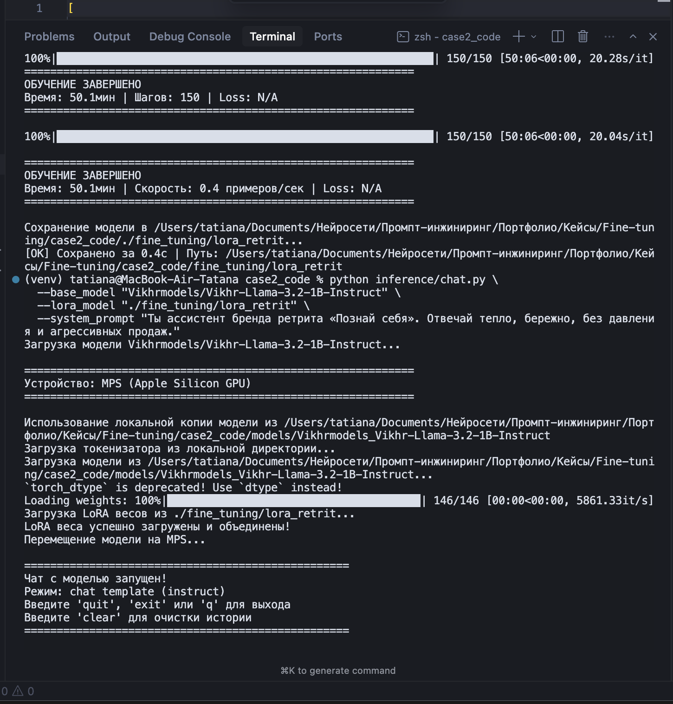

# Fine-tuning a local LLM to write in a brand's voice

The open language model Vikhr-Llama-3.2-1B-Instruct, fine-tuned with LoRA to write in a retreat brand's tone: stories, posts, answers to questions and objections. It runs locally, including on an Apple Silicon laptop.

This is a practice project. The retreat, "Know Yourself" («Познай себя»), is a training scenario of a retreat center, not a real organization. The model and the dataset are in Russian. Case study: [tatidzufri.com/en/case/llm-fine-tuning](https://tatidzufri.com/en/case/llm-fine-tuning).


## About the project

I took a ready general-purpose model and trained a small LoRA adapter on top of it, about 0.9% of the parameters. The original weights stay as they were. The adapter is attached to the base model when the chat starts.

Training and chat run on my own hardware, so the brand's texts and the requests go nowhere.

## The task

The retreat brand has a lot of texts in a recognizable tone: warm, honest, without loud slogans or pressure. New texts are needed all the time, and a general model out of the box sounds different from the brand.

I wanted to test whether the brand's voice can be built into the model itself, so it doesn't have to be described in every prompt. And to do it without the cloud and without a GPU farm.

## How it works

1. **A dataset from the brand's texts.** 300 examples in the "instruction, request, finished answer" format: 240 for training, 30 each for validation and test.
2. **LoRA with PEFT.** Only a small adapter is trained, so an ordinary laptop is enough and experiments with settings go fast.
3. **The model's chat template.** Each example becomes a "system, user, assistant" dialog. Loss is computed only on the assistant's answers, so the model doesn't memorize the prompt.
4. **Three devices.** The script picks MPS on Apple Silicon, CUDA with 4-bit quantization on NVIDIA, or CPU for a check.
5. **A terminal chat.** The base model on its own or with the adapter, optionally with a system prompt.

## What it looks like

**End of training and chat start.** The adapter is saved to `fine_tuning/lora_retrit`, and the chat starts with the base model and the adapter on MPS.



**A conversation with the model** (screenshot at the top). Questions about the retreat, what the program includes, how much it costs. Answers in the brand's tone.

## Results

- The brand's voice is built in at the model level, without a long style description in the prompt.
- The model runs locally, and the retreat data never leaves the computer.
- For stories and posts you can quickly get many phrasing variants.

What's not there yet. The model's texts are still drafts: a person picks the best variants and polishes them, and the model doesn't replace a copywriter. The adapter itself isn't in the repository; train it again with the command below.

## Tech stack

| Technology | What it's for |
|---|---|
| **PyTorch** | The compute the model runs and trains on |
| **Transformers** | Loading Vikhr-Llama and its tokenizer, the chat template for dialogs |
| **Datasets** | Reading jsonl, shuffling and batching |
| **PEFT** | LoRA: training a small adapter instead of the whole model |
| **Accelerate** | The same training on CPU, NVIDIA and Apple Silicon |
| **BitsAndBytes** | 4-bit quantization on NVIDIA so the model fits in memory |
| **SentencePiece** | Splitting text into tokens for the model |

## Repository structure

- `dataset_retrit_poznaisebia/`: the dataset (train, valid, test, the full file and a table for viewing).
- `fine_tuning/train.py`: adapter training. All parameters are described in `fine_tuning/README.md`.
- `inference/chat.py`: the terminal chat with the model. Examples in `inference/README.md`.
- `demo/`: screenshots.

## Running it

You need Python 3.10+. The base model downloads from Hugging Face on first start.

```bash
pip install -r requirements.txt

python fine_tuning/train.py \
  --model_name "Vikhrmodels/Vikhr-Llama-3.2-1B-Instruct" \
  --dataset_path "dataset_retrit_poznaisebia/train.jsonl" \
  --eval_dataset_path "dataset_retrit_poznaisebia/valid.jsonl" \
  --output_dir "./fine_tuning/lora_retrit" \
  --num_train_epochs 5 \
  --per_device_train_batch_size 2 \
  --gradient_accumulation_steps 4 \
  --learning_rate 2e-4 \
  --max_length 512 \
  --device auto

python inference/chat.py \
  --base_model "Vikhrmodels/Vikhr-Llama-3.2-1B-Instruct" \
  --lora_model "./fine_tuning/lora_retrit"
```

Commands for NVIDIA and CPU are in `fine_tuning/README.md`.

## Author

Tetiana Dziubas, AI automation engineer. I build Telegram bots, RAG assistants and LLM agents that take routine work off small teams. Case studies and contact: [tatidzufri.com/en](https://tatidzufri.com/en/).
