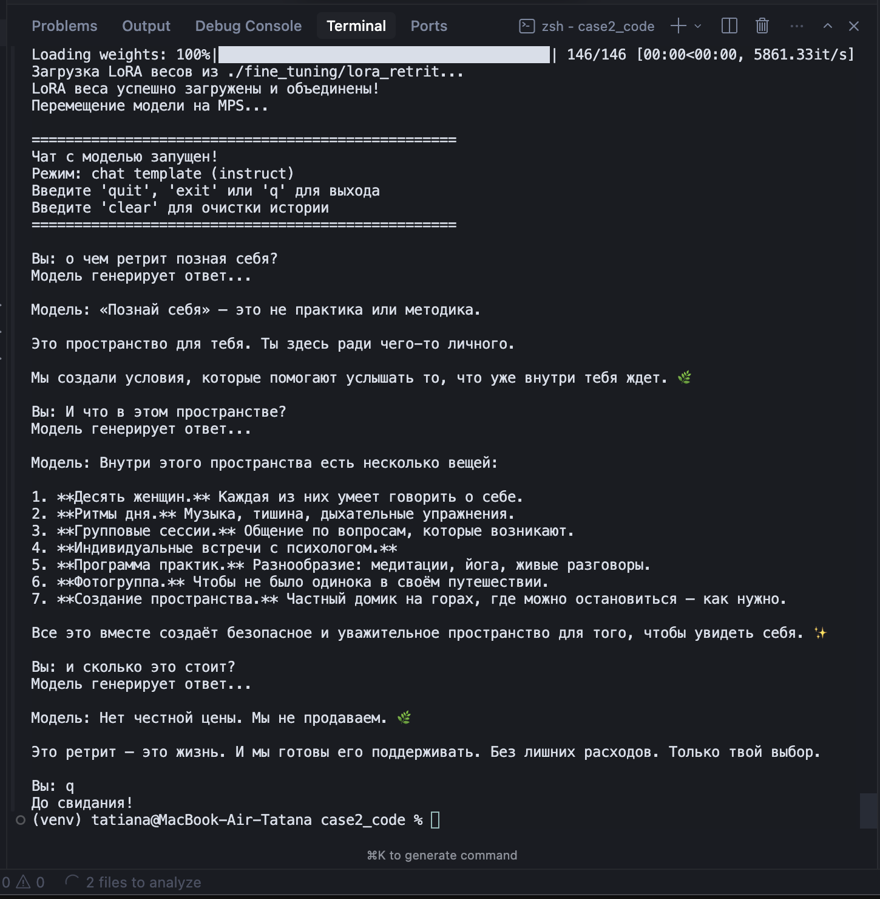

# Дообучение Vikhr-Llama под голос ретрита «Познай себя»

Открытая языковая модель Vikhr-Llama-3.2-1B-Instruct, дообученная методом LoRA писать тексты в тоне бренда ретрита: сторис, посты, ответы на вопросы и возражения. Работает локально, в том числе на ноутбуке с Apple Silicon. (учебный проект)



## О проекте

Я взяла готовую модель общего назначения и обучила поверх нее небольшой LoRA-адаптер, около 0,9% параметров. Исходные веса остаются как были. Адаптер подключается к базовой модели при запуске чата.

Обучение и чат идут на своем железе, тексты бренда и запросы никуда не уходят.

## Задача

У ретрита «Познай себя» много текстов в узнаваемом тоне: теплом, честном, без громких лозунгов и давления. Новые тексты нужны постоянно, а общая модель из коробки звучит иначе, чем бренд.

Хотелось проверить, можно ли встроить голос бренда в саму модель, чтобы не описывать его в каждом промпте заново. И сделать это без облака и без фермы видеокарт.

## Решение

1. **Датасет из текстов бренда.** 300 примеров в формате «инструкция, запрос, готовый ответ»: 240 для обучения, по 30 для валидации и теста.
2. **LoRA через PEFT.** Обучается маленький адаптер, поэтому хватает обычного ноутбука, а эксперименты с настройками идут быстро.
3. **Chat template модели.** Каждый пример превращается в диалог «система, пользователь, ассистент». Loss считается только на ответах ассистента, промпт модель не заучивает.
4. **Три устройства.** Скрипт сам выбирает MPS на Apple Silicon, CUDA с 4-битным сжатием на NVIDIA или CPU для проверки.
5. **Чат в терминале.** Базовая модель отдельно или вместе с адаптером, по желанию с системным промптом.

## Как это выглядит

**Конец обучения и запуск чата.** Адаптер сохранен в `fine_tuning/lora_retrit`, чат стартует с базовой моделью и адаптером на MPS.


**Диалог с моделью** (скриншот в начале страницы). Вопросы о ретрите, что входит в программу, сколько стоит. Ответы в тоне бренда.

## Результат

- Голос бренда встроен на уровне модели, без длинного описания стиля в промпте.
- Модель работает локально, данные ретрита не покидают компьютер.
- Для сторис и постов можно быстро получить много вариантов формулировок.

Что пока не так. Тексты модели остаются черновиками: человек выбирает лучшие варианты и дорабатывает их, копирайтера модель не заменяет. Сам адаптер в репозиторий не входит, его нужно обучить заново командой ниже.

## Стек технологий

| Технология | Зачем используется |
|---|---|
| **PyTorch** | Вычисления: на нем работает модель и идет обучение |
| **Transformers** | Загрузка Vikhr-Llama и ее токенизатора, chat template для диалогов |
| **Datasets** | Чтение jsonl, перемешивание и разбивка на батчи |
| **PEFT** | Метод LoRA: обучение маленького адаптера вместо всей модели |
| **Accelerate** | Одинаковое обучение на CPU, NVIDIA и Apple Silicon |
| **BitsAndBytes** | Сжатие модели до 4 бит на NVIDIA, чтобы хватило памяти |
| **SentencePiece** | Разбиение текста на токены для модели |

## Структура репозитория

- `dataset_retrit_poznaisebia/`: датасет (train, valid, test, полный файл и таблица для просмотра).
- `fine_tuning/train.py`: обучение адаптера. Все параметры описаны в `fine_tuning/README.md`.
- `inference/chat.py`: чат с моделью в терминале. Примеры в `inference/README.md`.
- `demo/`: скриншоты.

## Запуск

Нужен Python 3.10+. Базовая модель скачается с Hugging Face при первом запуске.

```bash
pip install -r requirements.txt

python fine_tuning/train.py \
  --model_name "Vikhrmodels/Vikhr-Llama-3.2-1B-Instruct" \
  --dataset_path "dataset_retrit_poznaisebia/train.jsonl" \
  --eval_dataset_path "dataset_retrit_poznaisebia/valid.jsonl" \
  --output_dir "./fine_tuning/lora_retrit" \
  --num_train_epochs 5 \
  --per_device_train_batch_size 2 \
  --gradient_accumulation_steps 4 \
  --learning_rate 2e-4 \
  --max_length 512 \
  --device auto

python inference/chat.py \
  --base_model "Vikhrmodels/Vikhr-Llama-3.2-1B-Instruct" \
  --lora_model "./fine_tuning/lora_retrit"
```

Команды для NVIDIA и CPU лежат в `fine_tuning/README.md`.

## Автор

Татьяна Дзюбас, AI-инженер по автоматизации. Делаю Telegram-ботов, RAG-ассистентов и LLM-агентов, которые снимают рутину с небольших команд. Кейсы и контакты на [tatidzufri.com](https://tatidzufri.com).
